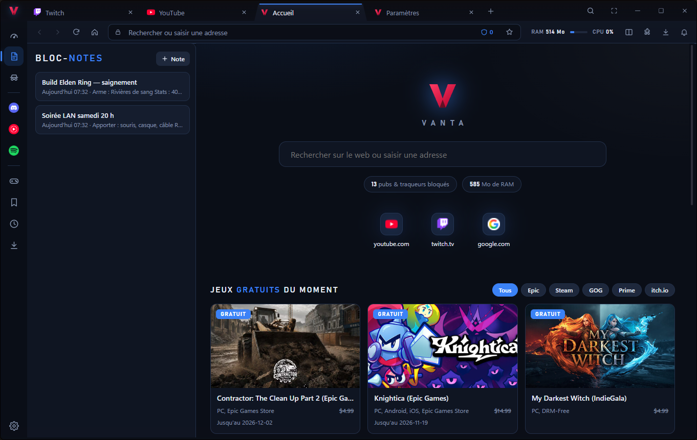
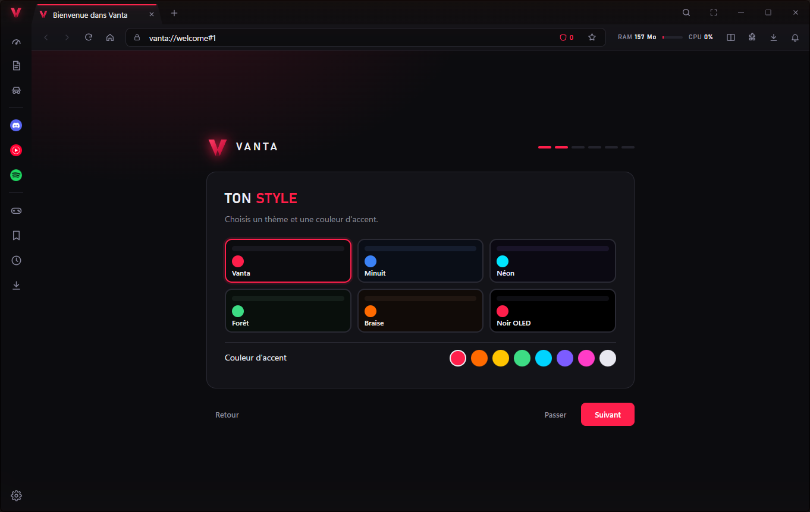

# Vanta

**Le navigateur gaming léger pour Windows.**
Il se fait discret quand tu joues, bloque les pubs par défaut et garde tes applis préférées à portée de clic.

### [⬇ Télécharger Vanta pour Windows](https://github.com/iZeyros/Vanta-browser/releases/latest/download/VantaSetup.exe)

**Français** · [English](docs/README.en.md)

 

## Pourquoi Vanta ?

Vanta est un navigateur pensé pour les joueurs, écrit en **Rust** et basé sur **WebView2**,
le moteur Chromium d'Edge déjà présent dans Windows. Résultat : un installateur léger, une
compatibilité avec tous les sites, une consommation de RAM surveillée de près et des outils
pour jouer sans que le navigateur te ralentisse.

## Fonctionnalités

### 🎮 Pensé pour le jeu
- **Vanta Core** : limite la **RAM**, le **CPU** et le **réseau** utilisés par le navigateur, avec graphiques en direct.
- **Mode jeu automatique** : dès qu'un jeu passe en plein écran, Vanta resserre ses limites et met en veille les onglets en arrière-plan. Il redevient normal quand tu quittes le jeu.
- **Onglets en veille** : les onglets inactifs sont suspendus puis déchargés (processus fermé), et ceux de la dernière session ne se chargent qu'au premier clic. Les applis du panneau latéral sont fermées quand tu fermes le panneau, sauf la musique (Spotify, ou toute appli qui joue du son).
- **Lecture automatique bloquée** : une vidéo ou un son qui démarre tout seul est mis en pause tant que tu n'as pas cliqué dans la page (réglable, exceptions par site depuis le cadenas).
- **Démarrage rapide** : le bloqueur est gardé prêt à l'emploi sur le disque (quelques millisecondes au lieu d'une demi-seconde).
- **RAM au plus bas** : un seul processus par site (l'interface et ses menus en partagent un), pas de pages préchargées en cachette, mémoire libérée en jeu et quand Vanta reste réduit, et onglets d'arrière-plan déchargés automatiquement si Windows manque de RAM.
- **Hub gaming** : la page d'accueil liste les jeux gratuits du moment (Epic, Steam, GOG, Prime Gaming, itch.io).
- **Alerte jeux gratuits** (au choix, désactivée par défaut) : une notification dès qu'un jeu devient gratuit sur les boutiques que tu suis, avec un bouton pour le récupérer.
- **Mode immersif** (F11) : plein écran sans aucune barre ; approche la souris du haut de l'écran pour les faire réapparaître.
- **Thèmes complets** : Vanta, Minuit, Néon, Forêt, Braise et Noir OLED changent toutes les couleurs de l'interface, en plus de la couleur d'accent.

### 🛡️ Confidentialité
- **Bloqueur de pubs et de traqueurs** intégré (moteur de Brave, listes EasyList, EasyPrivacy, uBlock et Liste FR). Un clic sur le bouclier ouvre son menu : pubs et traqueurs bloqués sur la page, domaines concernés, total depuis l'installation et interrupteur pour le site.
- **Navigation privée** (Ctrl+Maj+N) : fenêtre séparée dont l'historique, les cookies et les données de sites sont effacés à la fermeture.
- **Mots de passe et formulaires** : Vanta propose d'enregistrer tes mots de passe et remplit les formulaires (réglable, effaçable).
- **Autorisations des sites** : micro, caméra, position, notifications… Vanta te demande avant (« Autoriser » / « Bloquer ») et retient ton choix pour chaque site. Le cadenas de la barre d'adresse permet de changer d'avis.
- **Téléchargements surveillés** : un programme ou un script demande confirmation avant d'être ouvert, un faux document (« facture.pdf.exe ») est bloqué, un programme reçu sans chiffrement (http) est mis en pause, et chaque fichier est marqué comme venant d'Internet pour que Windows le vérifie.
- **Liens dangereux bloqués** : les liens qui lancent des outils de Windows utilisés par des attaques (`ms-msdt:`, `search-ms:`, `ms-appinstaller:`…) sont bloqués ; un site ne peut pas ouvrir les pages de réglages de Vanta.
- **Protection SmartScreen** de Microsoft activée par défaut.

### 🧭 Navigation
- **Mots-clés de recherche** : `yt minecraft` cherche sur YouTube, `w Paris` sur Wikipédia, `steam`, `tw`, `r`, `gh`, `amz`, `maps`… et tes propres mots-clés.
- **Extensions du Chrome Web Store et des modules Edge** : sur la page d'une extension, clique sur **+ Ajouter à Vanta** dans la barre d'adresse. Vanta télécharge le paquet officiel, vérifie sa signature, te montre ce qu'elle pourra faire, puis l'installe ; elle se met ensuite à jour toute seule.
- **Bouton Extensions** : active une extension, ouvre son popup sous le bouton ou ses options, en un clic.
- **Barre d'adresse intelligente** : suggestions tirées de tes onglets ouverts, favoris et historique, complétion automatique du site (« yout » → youtube.com) et, en option, suggestions du moteur de recherche.
- **Onglets épinglés** : compacts, toujours à gauche, gardés dans la session et jamais déchargés par la mise en veille automatique (clic droit sur un onglet › « Épingler »).
- **Zoom par site** : Ctrl+molette ou Ctrl+plus / moins, retenu pour chaque site (Ctrl+0 pour revenir à 100 %).
- **Récupération après un plantage** : une page qui plante se recharge toute seule, un onglet en arrière-plan est simplement rechargé quand tu y reviens, et si le moteur web s'arrête entièrement, Vanta redémarre et restaure tes onglets.
- **Bloc-notes** dans le panneau latéral : notes enregistrées automatiquement sur ton PC (codes, builds, astuces…).
- **Panneau latéral** : Discord, YouTube Music, Spotify ou tes propres sites, en version mobile ou bureau, avec largeur et zoom réglables. La musique continue pendant que tu navigues.
- **Lecteur réduit** : survole une vidéo (YouTube, Twitch…) et clique sur « Lecteur réduit ». Elle flotte au-dessus de toutes tes fenêtres, même en jeu.
- **Écran partagé** : deux pages côte à côte (Ctrl+clic sur un onglet).
- **Groupes d'onglets** : nom, couleur, repliables d'un clic (clic droit sur un onglet › « Nouveau groupe »).
- **Recherche d'onglets** (Ctrl+Espace) : retrouve un onglet ouvert, un favori ou une page de l'historique.
- **Barre de favoris en glisser-déposer** : range tes favoris et dossiers dans l'ordre que tu veux, dépose-y un onglet, un lien d'une page ou un favori de la page des favoris. Un clic sur un dossier ouvre son menu, avec ses sous-dossiers en cascade.
- **Mode lecture** (F9) : l'article seul, sans pub ni menu, avec taille, police et thème réglables. **Traduction** des pages en un clic.
- **Fonds d'écran d'accueil** : aurore, grille rétro, particules, ou ton image, GIF ou vidéo.
- **Favoris avec dossiers** (sélection multiple), historique, et menu des téléchargements avec progression et temps restant.
- **Import** des favoris et de l'historique depuis Chrome, Edge, Brave, Opera et Opera GX, et **export** des favoris en fichier HTML standard.
- **Journal de diagnostic** local (aucune télémétrie) : en cas de problème, *Réglages › Diagnostic › Copier le rapport* pour ouvrir un ticket.
- **Notifications regroupées** : téléchargements, mises à jour, mode jeu… s'affichent toutes au même endroit, dans le même style, et restent consultables dans le centre de notifications (cloche).
- **En français ou en anglais** : la langue de Windows est choisie automatiquement, modifiable dans *Réglages › Général*.
- **Assistant de premier lancement** : langue, thème, recherche, bloqueur, jeux gratuits et import de tes favoris en quelques clics.
- **Infobulles, menus et notifications** au style de Vanta, et réglages appliqués immédiatement partout, sans recharger les pages.

## Installation

1. Télécharge **[VantaSetup.exe](https://github.com/iZeyros/Vanta-browser/releases/latest/download/VantaSetup.exe)**.
2. Lance-le et choisis **n'importe quel dossier** : un autre disque, un dossier de jeux… Pour un dossier protégé comme `C:\Program Files`, il demande les droits administrateur.
3. Choisis tes options : raccourcis sur le Bureau et dans le menu Démarrer, lancement au démarrage de Windows.

**Version Microsoft Store :** Vanta est aussi publié sur le Microsoft Store. Cette version est signée par
Microsoft (aucun avertissement de Windows) et mise à jour par le Store.

L'installateur télécharge toujours la dernière version. **Vanta se met ensuite à jour tout seul** : il télécharge la nouvelle version en arrière-plan puis te propose de redémarrer (réglable dans *Réglages › Mises à jour*).

**Configuration requise :** Windows 10 ou 11 (64 bits) avec le composant Microsoft Edge WebView2, déjà présent sur Windows 11 et sur les Windows 10 à jour.

**Désinstallation :** *Paramètres Windows › Applications › Vanta › Désinstaller*. Tu peux choisir de garder ou d'effacer tes données.

## Raccourcis clavier

| Raccourci | Action |
|---|---|
| `Ctrl+T` / `Ctrl+W` | Nouvel onglet / fermer l'onglet |
| `Ctrl+Maj+T` | Rouvrir le dernier onglet fermé |
| `Ctrl+Tab` · `Ctrl+1…9` | Onglet suivant · aller à l'onglet n |
| `Ctrl+Maj+N` | Fenêtre de navigation privée |
| `Ctrl+Espace` | Rechercher un onglet, un favori, l'historique |
| `F9` | Mode lecture |
| `F11` | Mode immersif (plein écran sans barres) |
| `Ctrl+L` / `F6` | Barre d'adresse (↑ ↓ pour choisir une suggestion) |
| `Ctrl+molette` · `Ctrl+plus` / `Ctrl+moins` · `Ctrl+0` | Zoom de la page (retenu pour le site) · 100 % |
| `Ctrl+D` | Ajouter aux favoris |
| `Ctrl+H` / `Ctrl+J` | Historique / téléchargements |
| `Ctrl+Maj+O` | Gestionnaire de favoris |
| `F12` | Outils de développement (sur les sites) |

## Sécurité des mises à jour

Chaque version est **signée** avec une clé que seul l'auteur possède. Vanta vérifie cette
signature, qui couvre le numéro de version et le contenu exact du fichier, avant toute
installation : un fichier modifié ou une ancienne version déguisée est refusé.

## Questions fréquentes

**Vanta consomme-t-il moins de RAM que Chrome ?**
Une page consomme autant que dans n'importe quel navigateur Chromium. La différence vient
de la gestion des onglets : veille, déchargement, chargement à la demande et plafonds de Vanta Core.

**Pourquoi le Gestionnaire des tâches n'affiche-t-il que quelques Mo pour `vanta.exe` ?**
`vanta.exe` ne contient que l'interface. Les pages tournent dans les processus
« Microsoft Edge WebView2 » que Vanta lance : déplie le groupe Vanta dans le Gestionnaire
des tâches pour les voir. Vanta Core additionne les deux et affiche le détail
(interface / moteur web), en mémoire privée comme la colonne « Mémoire » du Gestionnaire.

**Un site du panneau latéral s'affiche mal ?**
Clique sur « Mobile » dans la barre du panneau pour passer en version bureau, puis ajuste la largeur ou le zoom.

**Où sont mes données ?**
Dans `%APPDATA%\Vanta`, uniquement sur ton PC. Vanta n'a pas de compte et n'envoie aucune statistique
(voir la [politique de confidentialité](docs/CONFIDENTIALITE.md)).

**Windows affiche « Windows a protégé votre ordinateur » ?**
L'installateur de GitHub n'est pas signé : clique sur *Informations complémentaires › Exécuter quand même*.
Si ton PC utilise le *contrôle intelligent des applications*, qui bloque sans proposer de contourner, installe
plutôt la version du **Microsoft Store** : elle est signée par Microsoft et n'est jamais bloquée.

## Développement

La compilation, l'architecture et la publication des versions sont décrites dans
[docs/DEVELOPPEMENT.md](docs/DEVELOPPEMENT.md), la publication sur le Microsoft Store dans [docs/SIGNATURE.md](docs/SIGNATURE.md).

## Licence

Vanta est un logiciel libre sous [licence MIT](LICENSE). Le mode lecture utilise
[Readability](https://github.com/mozilla/readability) de Mozilla (licence Apache 2.0).

---

Vanta

