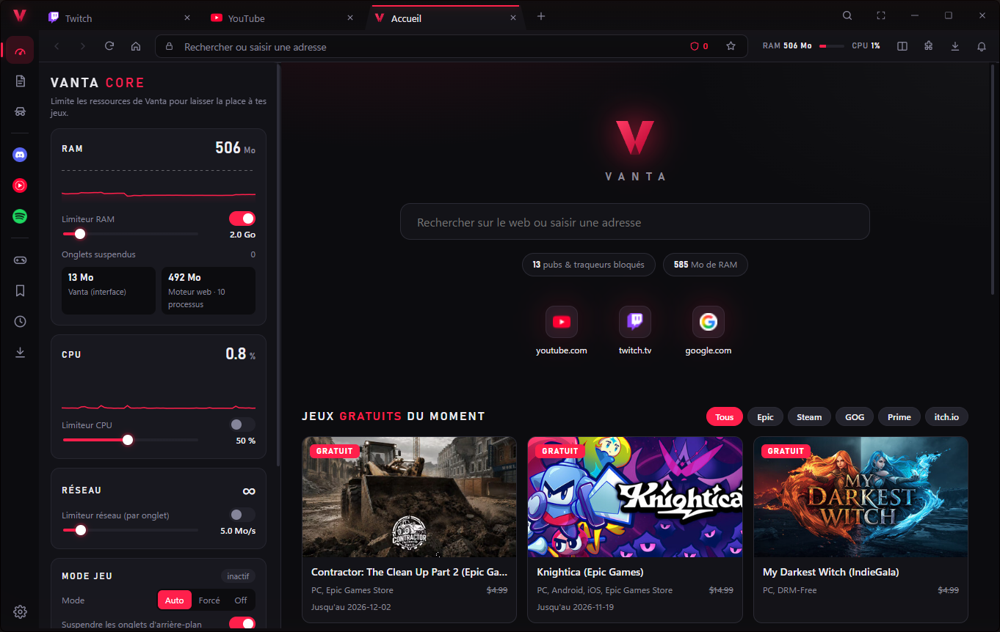
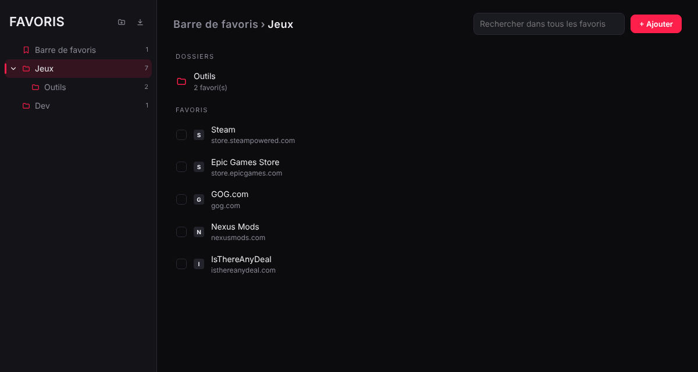

# Vanta

**Le navigateur gaming léger pour Windows.**
Il se fait discret quand tu joues, bloque les pubs par défaut et garde tes applis préférées à portée de clic.

### [⬇ Télécharger Vanta pour Windows](https://github.com/iZeyros/Vanta-browser/releases/latest/download/VantaSetup.exe)

 

## Pourquoi Vanta ?

Vanta est un navigateur inspiré d'Opera GX, écrit en **Rust** et basé sur **WebView2**,
le moteur Chromium d'Edge déjà présent dans Windows. Résultat : un installateur léger, une
compatibilité avec tous les sites et des outils pensés pour les joueurs.

## Fonctionnalités

### 🎮 Pensé pour le jeu
- **GX Control** : limite la **RAM**, le **CPU** et le **réseau** utilisés par le navigateur, avec graphiques en direct.
- **Mode jeu automatique** : dès qu'un jeu passe en plein écran, Vanta resserre ses limites et met en veille les onglets en arrière-plan. Il redevient normal quand tu quittes le jeu.
- **Onglets en veille** : les onglets inactifs sont suspendus, et ceux de la dernière session ne se chargent qu'au premier clic.
- **Hub gaming** : la page d'accueil liste les jeux gratuits du moment (Epic, Steam, GOG, Prime Gaming, itch.io).

### 🛡️ Confidentialité
- **Bloqueur de pubs et de traqueurs** intégré (moteur de Brave, listes EasyList, EasyPrivacy, uBlock et Liste FR). Un clic sur le bouclier ouvre son menu : pubs et traqueurs bloqués sur la page, domaines concernés, total depuis l'installation et interrupteur pour le site.
- **Navigation privée** (Ctrl+Maj+N) : fenêtre séparée dont l'historique, les cookies et les données de sites sont effacés à la fermeture.
- **Protection SmartScreen** de Microsoft activée par défaut.

### 🧭 Navigation
- **Panneau latéral** : Discord, YouTube Music, Spotify ou tes propres sites, en version mobile ou bureau, avec largeur et zoom réglables. La musique continue pendant que tu navigues.
- **Lecteur réduit** : survole une vidéo (YouTube, Twitch…) et clique sur « Lecteur réduit ». Elle flotte au-dessus de toutes tes fenêtres, même en jeu.
- **Écran partagé** : deux pages côte à côte (Ctrl+clic sur un onglet).
- **Favoris avec dossiers** (glisser-déposer, sélection multiple), historique, et menu des téléchargements avec progression et temps restant.
- **Import** des favoris et de l'historique depuis Chrome, Edge, Brave, Opera et Opera GX.
- **Notifications regroupées** : téléchargements, mises à jour, mode jeu… s'affichent toutes au même endroit, dans le même style, et restent consultables dans le centre de notifications (cloche).
- Extensions Chrome (version décompressée), thème sombre avec couleur d'accent au choix.

## Installation

1. Télécharge **[VantaSetup.exe](https://github.com/iZeyros/Vanta-browser/releases/latest/download/VantaSetup.exe)**.
2. Lance-le et choisis **n'importe quel dossier** : un autre disque, un dossier de jeux… Pour un dossier protégé comme `C:\Program Files`, il demande les droits administrateur.
3. Choisis tes options : raccourcis sur le Bureau et dans le menu Démarrer, lancement au démarrage de Windows.

L'installateur télécharge toujours la dernière version. **Vanta se met ensuite à jour tout seul** : il télécharge la nouvelle version en arrière-plan puis te propose de redémarrer (réglable dans *Réglages › Mises à jour*).

**Configuration requise :** Windows 10 ou 11 (64 bits) avec le composant Microsoft Edge WebView2, déjà présent sur Windows 11 et sur les Windows 10 à jour.

**Désinstallation :** *Paramètres Windows › Applications › Vanta › Désinstaller*. Tu peux choisir de garder ou d'effacer tes données.

## Raccourcis clavier

| Raccourci | Action |
|---|---|
| `Ctrl+T` / `Ctrl+W` | Nouvel onglet / fermer l'onglet |
| `Ctrl+Maj+T` | Rouvrir le dernier onglet fermé |
| `Ctrl+Tab` · `Ctrl+1…9` | Onglet suivant · aller à l'onglet n |
| `Ctrl+Maj+N` | Fenêtre de navigation privée |
| `Ctrl+L` / `F6` | Barre d'adresse |
| `Ctrl+D` | Ajouter aux favoris |
| `Ctrl+H` / `Ctrl+J` | Historique / téléchargements |
| `Ctrl+Maj+O` | Gestionnaire de favoris |
| `F12` | Outils de développement |

## Sécurité des mises à jour

Chaque version est **signée** avec une clé que seul l'auteur possède. Vanta vérifie cette
signature, qui couvre le numéro de version et le contenu exact du fichier, avant toute
installation : un fichier modifié ou une ancienne version déguisée est refusé.

## Questions fréquentes

**Vanta consomme-t-il moins de RAM que Chrome ?**
Une page consomme autant que dans n'importe quel navigateur Chromium. La différence vient
de la gestion des onglets : veille, déchargement, chargement à la demande et plafonds du GX Control.

**Pourquoi le Gestionnaire des tâches n'affiche-t-il que quelques Mo pour `vanta.exe` ?**
`vanta.exe` ne contient que l'interface. Les pages tournent dans les processus
« Microsoft Edge WebView2 » que Vanta lance : déplie le groupe Vanta dans le Gestionnaire
des tâches pour les voir. Le GX Control additionne les deux et affiche le détail
(interface / moteur web), en mémoire privée comme la colonne « Mémoire » du Gestionnaire.

**Un site du panneau latéral s'affiche mal ?**
Clique sur « Mobile » dans la barre du panneau pour passer en version bureau, puis ajuste la largeur ou le zoom.

**Où sont mes données ?**
Dans `%APPDATA%\Vanta`, uniquement sur ton PC. Vanta n'a pas de compte et n'envoie aucune statistique.

## Développement

La compilation, l'architecture et la publication des versions sont décrites dans
[docs/DEVELOPPEMENT.md](docs/DEVELOPPEMENT.md).

---

Vanta

