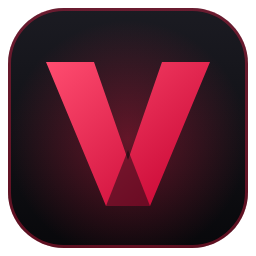

# Vanta

**The lightweight gaming browser for Windows.**
It keeps a low profile while you play, blocks ads by default and keeps your favourite apps one click away.

### [⬇ Download Vanta for Windows](https://github.com/iZeyros/Vanta-browser/releases/latest/download/VantaSetup.exe)

[Français](../README.md) · **English**

 

## Why Vanta?

Vanta is a browser made for gamers, written in **Rust** and built on **WebView2**, the Chromium
engine of Microsoft Edge that already ships with Windows. The result: a small installer,
compatibility with every site, closely watched RAM use and tools to play without your browser
slowing you down.

The interface is available in **English** and **French** (Windows' language is picked
automatically; change it in *Settings › General*).

## Features

### 🎮 Made for gaming
- **Vanta Core**: limits the **RAM**, **CPU** and **network** used by the browser, with live graphs.
- **Automatic game mode**: as soon as a game goes full screen, Vanta tightens its limits and suspends background tabs.
- **Sleeping tabs**: inactive tabs are suspended and then unloaded, and tabs from your last session only load when you click them.
- **Autoplay blocked**: a video or sound that starts on its own is paused until you click in the page (per-site exceptions).
- **Gaming hub**: the home page lists today's free games (Epic, Steam, GOG, Prime Gaming, itch.io).
- **Free games alert** (optional): a notification as soon as a game becomes free on the stores you follow.
- **Immersive mode** (F11): full screen with no bars; move the mouse to the top of the screen to bring them back.
- **Full themes**: Vanta, Midnight, Neon, Forest, Ember and OLED black, plus your own accent colour.

### 🛡️ Privacy
- **Built-in ad and tracker blocker** (Brave's engine, EasyList, EasyPrivacy, uBlock filters).
- **Private browsing** (Ctrl+Shift+N): history, cookies and site data are cleared when the window closes.
- **Site permissions**: microphone, camera, location… Vanta asks first and remembers your choice for each site.
- **Watched downloads**: fake documents (“invoice.pdf.exe”) are blocked, programs sent without encryption are paused, and Vanta asks before opening a program.
- **No account, no telemetry.** See the [privacy policy](CONFIDENTIALITE.md) (in French).

### 🧭 Browsing
- **Smart address bar**: suggestions from your tabs, bookmarks and history, site completion and search keywords (`yt minecraft`, `w Paris`, `steam`…).
- **Extensions from the Chrome Web Store and Microsoft Edge Add-ons**: click **+ Add to Vanta** on an extension's page. Vanta checks the package's signature, shows its permissions and keeps it up to date.
- **Notepad** in the side panel, **Discord, YouTube Music, Spotify** or your own sites in the side panel.
- **Mini player**, **split screen**, **tab groups**, **pinned tabs**, **per-site zoom**, **reader mode** (F9) and **page translation**.
- **Import** bookmarks and history from Chrome, Edge, Brave and Opera, **export** bookmarks to a standard HTML file.
- **Crash recovery**: a crashed page reloads by itself and your tabs are restored.

## Installation

1. Download **[VantaSetup.exe](https://github.com/iZeyros/Vanta-browser/releases/latest/download/VantaSetup.exe)** and run it.
2. Pick **any folder** (another drive, a games folder…). A protected folder such as `C:\Program Files` asks for administrator rights.
3. On first launch, a short assistant sets up the language, theme, search, blocker and free games, and can import your bookmarks.

Vanta then **updates itself**: every version is signed and checked before it is installed.

**Microsoft Store version:** Vanta is also on the Microsoft Store. That version is signed by Microsoft (no Windows warning) and updated by the Store.

**Requirements:** Windows 10 or 11 (64-bit) with Microsoft Edge WebView2, already included in Windows 11 and up-to-date Windows 10.

**“Windows protected your PC”?** The GitHub installer isn't code-signed: click *More info › Run anyway*, or install the Microsoft Store version.

## Keyboard shortcuts

| Shortcut | Action |
|---|---|
| `Ctrl+T` / `Ctrl+W` | New tab / close tab |
| `Ctrl+Shift+T` | Reopen the last closed tab |
| `Ctrl+Shift+N` | Private window |
| `Ctrl+Space` | Search tabs, bookmarks and history |
| `F9` | Reader mode |
| `F11` | Immersive mode |
| `Ctrl+L` / `F6` | Address bar |
| `Ctrl+wheel` · `Ctrl+0` | Zoom (remembered per site) · 100% |
| `Ctrl+D` | Bookmark the page |
| `Ctrl+H` / `Ctrl+J` | History / downloads |

## Licence

MIT. Vanta uses Mozilla's Readability.js (Apache-2.0) for reader mode.
