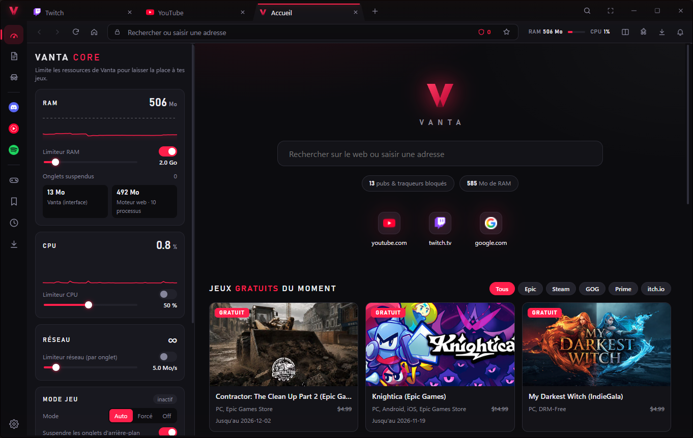
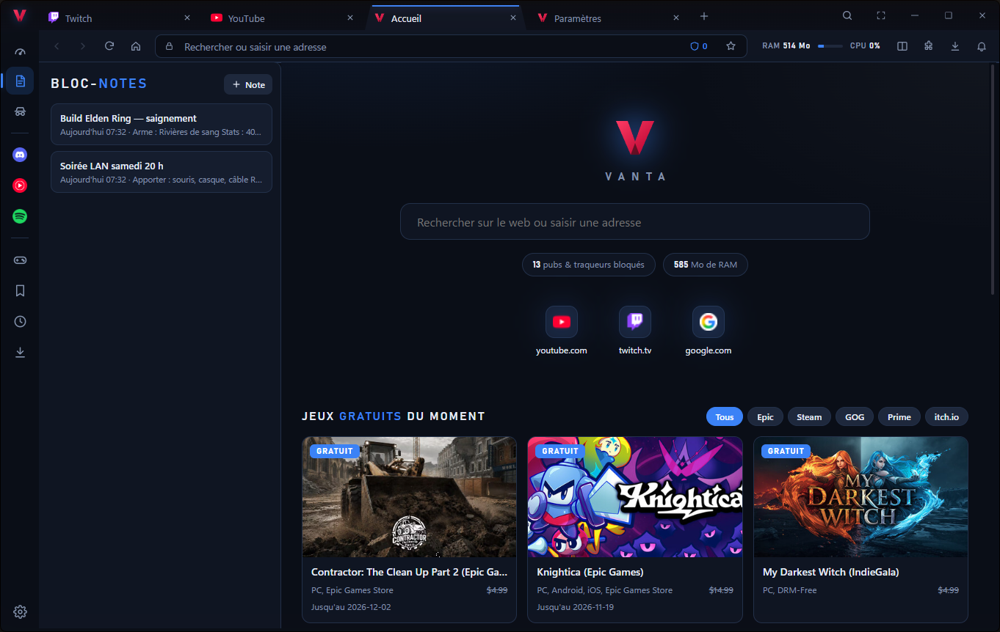

# Vanta

**The lightweight gaming browser for Windows.**
It keeps a low profile while you play, blocks ads by default and keeps your favourite apps one click away.

### [⬇ Download Vanta for Windows](https://github.com/iZeyros/Vanta-browser/releases/latest/download/VantaSetup.exe)

[Français](../README.md) · **English**

 

## Why Vanta?

Vanta is a browser made for gamers, written in **Rust** and built on **WebView2**, the Chromium
engine of Microsoft Edge that already ships with Windows. The result: a small installer,
compatibility with every site, closely watched RAM use and tools to play without your browser
slowing you down.

The interface is available in **English** and **French** (Windows' language is picked
automatically; change it in *Settings › General*).

## Features

### 🎮 Made for gaming
- **Vanta Core**: limits the **RAM**, **CPU** and **network** used by the browser, with live graphs.
- **Automatic game mode**: as soon as a game goes full screen, Vanta tightens its limits and suspends background tabs.
- **Sleeping tabs**: inactive tabs are suspended and then unloaded, and tabs from your last session only load when you click them.
- **Autoplay blocked**: a video or sound that starts on its own is paused until you click in the page (per-site exceptions).
- **Gaming hub**: the home page lists today's free games (Epic, Steam, GOG, Prime Gaming, itch.io).
- **Free games alert** (optional): a notification as soon as a game becomes free on the stores you follow.
- **Wishlist and price alerts**: add games from the start page, Vanta shows the best price across stores (Steam, Epic, GOG, Humble…, via CheapShark) and lets you know when one goes on sale (minimum discount of your choice, all-time low always reported).
- **Immersive mode** (F11): full screen with no bars; move the mouse to the top of the screen to bring them back.
- **Full themes**: Vanta, Midnight, Neon, Forest, Ember and OLED black, plus your own accent colour.

### 🛡️ Privacy
- **Built-in ad and tracker blocker** (Brave's engine, EasyList, EasyPrivacy, uBlock Origin lists, plus 230,000 ad, tracker, telemetry and scam domains in strong mode; optional Maximum level for cookie banners, share buttons and support chats). Blocked requests really fail, like with uBlock Origin, iframes included, ad slots are hidden on every site and uBlock Origin scriptlets are supported (YouTube video ads before, during and after videos, adblock detection). Global Privacy Control signal sent to sites.
- **Fingerprinting protection**: sites that identify your browser by drawing an image (canvas) or computing a sound get a slightly scrambled result, different on each site and at each launch.
- **Private browsing** (Ctrl+Shift+N): history, cookies and site data are cleared when the window closes.
- **Tor window** (onion button in the sidebar, or Ctrl+Shift+X): a private window where everything goes through the Tor network, with no way to turn it off. Reach **.onion sites**, search with DuckDuckGo over .onion, standardized time zone and language, WebRTC blocked, scrambled fingerprint. A .onion link opened elsewhere opens there automatically.
- **Built-in VPN** (VPN button next to the shield, or Ctrl+Shift+E): one click routes everything through the Tor network and hides your IP address from sites, with nothing to install and no account. Your tabs and site logins are kept; a “New identity” button changes your address.
- **Site permissions**: microphone, camera, location… Vanta asks first and remembers your choice for each site.
- **Watched downloads**: fake documents (“invoice.pdf.exe”) are blocked, programs sent without encryption are paused, and Vanta asks before opening a program.
- **No account, no telemetry.** See the [privacy policy](CONFIDENTIALITE.md) (in French).

### 🧭 Browsing
- **Smart address bar**: suggestions from your tabs, bookmarks and history, site completion and search keywords (`yt minecraft`, `w Paris`, `steam`…).
- **Extensions from the Chrome Web Store and Microsoft Edge Add-ons**: click **+ Add to Vanta** on an extension's page. Vanta checks the package's signature, shows its permissions and keeps it up to date.
- **Notepad** in the side panel, **Discord, YouTube Music, Spotify** or your own sites in the side panel.
- **Mini player**, **split screen**, **tab groups**, **pinned tabs**, **per-site zoom**, **reader mode** (F9) and **page translation**.
- **Full themes** (like Opera GX mods): Lofi, Synthwave, Space, Sakura, Arcade… colors, font, tab shape, animated wallpaper, **typing sounds** and **background music** composed live (no files). Create your own, export them as `.vantatheme`, import other people's, or use your own sounds.
- **Searchable settings**: type “music”, “ads” or “ram” to find the right setting.
- **Deep customization**: custom theme (background, text, corner rounding), choose and reorder the toolbar buttons and the home page blocks (clock, search, top sites…), compact mode, tab width, sidebar on the left, the right or hidden.
- **Screenshots** (Ctrl+Shift+S): an area, the visible part or the full page, saved to *Pictures › Vanta* and copied to the clipboard.
- **Forced dark mode**: darkens websites that have no dark theme, with per-site exceptions (padlock).
- **Import** bookmarks and history from Chrome, Edge, Brave and Opera, **export** bookmarks to a standard HTML file.
- **Crash recovery**: a crashed page reloads by itself and your tabs are restored.

## Installation

1. Download **[VantaSetup.exe](https://github.com/iZeyros/Vanta-browser/releases/latest/download/VantaSetup.exe)** and run it.
2. Pick **any folder** (another drive, a games folder…). A protected folder such as `C:\Program Files` asks for administrator rights.
3. On first launch, a short assistant sets up the language, theme, search, blocker and free games, and can import your bookmarks.

Vanta then **updates itself**: every version is signed and checked before it is installed.

**Microsoft Store version:** Vanta is also on the Microsoft Store. That version is signed by Microsoft (no Windows warning) and updated by the Store.

**Requirements:** Windows 10 or 11 (64-bit) with Microsoft Edge WebView2, already included in Windows 11 and up-to-date Windows 10.

**“Windows protected your PC”?** The GitHub installer isn't code-signed: click *More info › Run anyway*, or install the Microsoft Store version.

## Keyboard shortcuts

| Shortcut | Action |
|---|---|
| `Ctrl+T` | New tab |
| `Ctrl+N` | New window |
| `Drag a tab` | Out of the window: new window; onto another window: it joins it |
| `Ctrl+W · Ctrl+F4` | Close the tab |
| `Ctrl+Shift+T` | Reopen the last closed tab |
| `Ctrl+Tab · Ctrl+Shift+Tab` | Next · previous tab (also Ctrl+PgDn / PgUp) |
| `Ctrl+1…8 · Ctrl+9` | Go to tab n · to the last tab |
| `Ctrl+Shift+PgDn / PgUp` | Move the tab right / left |
| `Ctrl+M` | Mute or unmute the tab |
| `Middle click · Ctrl+click` | Open a link in a background tab (Ctrl+Shift+click: in front) |
| `Ctrl+L · F6 · Alt+D` | Address bar |
| `Ctrl+Shift+A` | Search tabs, bookmarks and history |
| `Ctrl+D` | Bookmark the page |
| `Ctrl+Shift+B` | Show or hide the bookmarks bar |
| `Ctrl+Shift+O` | Bookmark manager |
| `Ctrl+H · Ctrl+J` | History · downloads |
| `Alt+P` | Settings |
| `Ctrl+Shift+Del` | Clear browsing data |
| `Alt+Home` | Home page |
| `Ctrl+Shift+N` | Private window |
| `Ctrl+Shift+X` | Tor window (anonymous, .onion sites) |
| `Ctrl+Shift+E` | Turn the VPN on or off |
| `Ctrl+Shift+S` | Screenshot of an area of the page |
| `F5 · Ctrl+R` | Reload |
| `Alt+← · Alt+→` | Previous · next page |
| `Ctrl+F` | Find in page |
| `Ctrl+wheel · Ctrl+plus / minus · Ctrl+0` | Page zoom (remembered per site) · 100% |
| `F9` | Reader mode |
| `F11` | Immersive mode (full screen without bars) |
| `Ctrl+U` | Page source |
| `F12 · Ctrl+Shift+I` | Developer tools (on websites) |

All shortcuts are also listed in *Settings › Keyboard shortcuts*.

## Licence

MIT. Vanta uses Mozilla's Readability.js (Apache-2.0) for reader mode.
